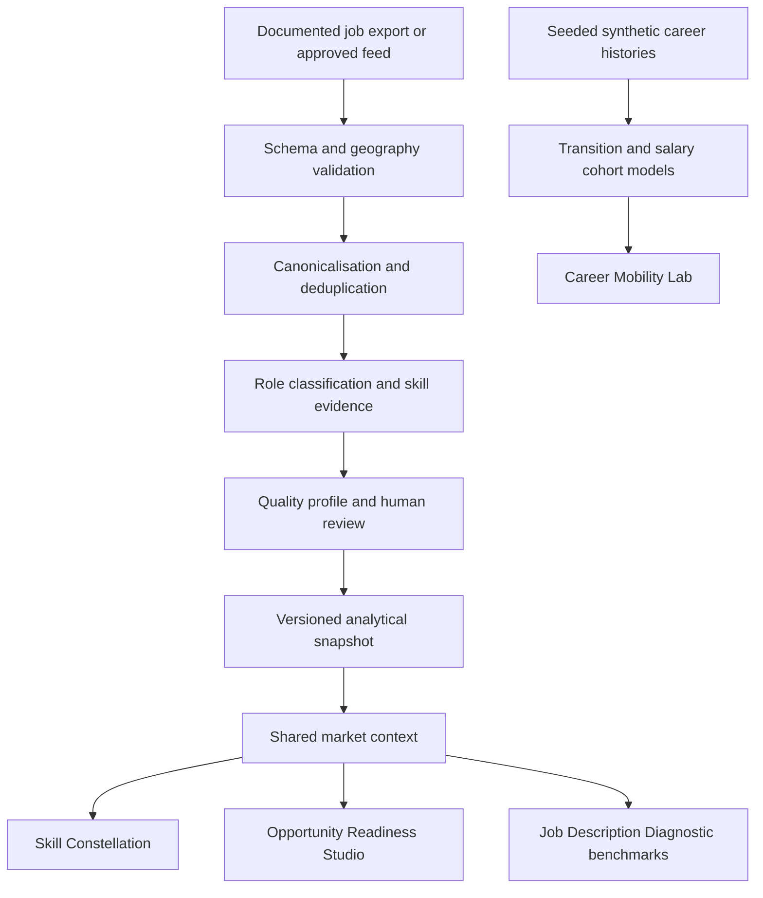

# Dublin Analytics Career Radar

## Master project description and feature specification

**Version:** 1.0 · **Date:** 18 October 2026 · **State:** agreed four-feature scope, with implementation status recorded below.

This is the primary product specification. Where older brainstorming notes or roadmaps differ, this document defines the intended scope. Planned requirements and acceptance criteria describe future work, not completed capabilities.

## 1. Purpose

Dublin Analytics Career Radar is an evidence-backed career intelligence application for technology careers in the Republic of Ireland, with Dublin shown separately. It connects observed job requirements, skill relationships, candidate evidence, career scenarios and job-description quality through four focused analytical experiences.

The primary project objective is to demonstrate the capabilities of a data/business analyst to recruiters, hiring managers and senior executives. The application should make the creator's ability to frame a business problem, model data, write SQL, validate analysis, design useful interactions and communicate decisions directly inspectable. Commercial potential is a future hypothesis rather than an established outcome.

The project remains separate from Telco Churn Analysis. Its existing repository name is retained for continuity even though the scope now extends beyond analytics occupations.

### Product proposition

> Understand how skills connect, assess the evidence behind career readiness, explore career transitions under explicit assumptions, and diagnose the quality of a job description.

The shared job-market dashboard is the analytical foundation of these experiences, rather than a fifth flagship product. The product does not need a large volume of features to demonstrate depth: every flagship must answer a distinct question and support an explainable decision.

### Intended audiences

| Audience | Decision supported | Value demonstrated |
|---|---|---|
| Students and early-career candidates | Which advertised requirements can I evidence, and what is missing? | Explainable alignment and practical evidence gaps |
| Career changers | How do role requirements overlap, and how do simulated transition outcomes vary? | Skill relationships and careful cohort analysis |
| Recruiters and hiring managers | Is a job description clear, consistent and explicit? | Requirements quality and traceable diagnostics |
| Senior executives reviewing the portfolio | Can the analyst translate imperfect data into a defensible decision? | Executive summaries, uncertainty, reproducibility and judgement |
| Technical interviewers | How are data, metrics and quality controls implemented? | SQL models, tests, lineage, architecture and documented trade-offs |

## 2. Selected scope and user experience

The four flagships are:

1. **Skill Constellation** — an interactive network of skills mentioned together in job advertisements.
2. **Opportunity Readiness Studio** — an explainable comparison between candidate-supplied evidence and advertised requirements.
3. **Career Mobility Lab** — synthetic career-history and compensation analysis with linked visual exploration.
4. **Job Description Diagnostic** — evidence-linked analysis of a description's completeness, clarity and consistency.

The main navigation should use these four names, with a secondary Methodology/About route. Show a short introductory summary and dataset status before asking users to explore complex charts. Each module should lead with a useful question, then expose detail progressively.

A shared coverage panel provides geography, source, sample size, collection window when known, last successful processing time, extraction version, review status and limitations. Users must be able to tell whether they are looking at observed data, self-reported evidence or synthetic scenarios.

### Scope boundaries

- Geography: Republic of Ireland. Separate Dublin, rest of Ireland and Ireland listings without a specified locality. Do not silently include Northern Ireland/UK records.
- Observed occupation scope: the current 21 technology role families, including the original analytics roles. This does not exhaust all technology occupations.
- Initial observed-data target: approximately 200 unique postings. The prepared collection input permits up to 315 candidate results before deduplication; actual results may be fewer.
- Collection design: selected title searches with caps. Role counts describe the sample, not Ireland-wide occupation prevalence or employer hiring success.
- Mobility scope: synthetic technical and adjacent non-technical occupation families, with occupation and employer industry modelled separately.
- No automated application submission, employer-side candidate ranking, CV rejection, predicted callback probabilities or generic chatbot in this release.
- No requirement for candidate accounts or persistent CV storage.

## 3. Shared job-market data foundation

### 3.1 Inputs and source status

Support documented user-provided exports, official APIs with suitable permissions and reviewed company careers feeds. An existing user-provided Apify LinkedIn export is available for private development. The user confirmed source review; independent platform authorisation has not been established. Confirm collection, retention and display permissions before public commercial use.

Apify is a replaceable source adapter, not the product's architecture. No LinkedIn login, cookie or personal profile is needed by the current local importer. Do not implement direct LinkedIn or Indeed scraping as part of this specification.

The Adzuna connector is retained as experimental: its Ireland search route returned HTTP 404, and Ireland support/account requirements remain unverified. It is not a dependency of the four-feature product.

### 3.2 Data pipeline

There is no data merge between simulated compensation outcomes and observed job requirements. A common occupation taxonomy can support navigation, but it must not make synthetic outcomes appear observed.

### 3.3 Required job data and lineage

Each imported record needs a source job ID, canonical job URL, title, employer, location and description. Posting date may be unknown. Preserve source identity, source-run reference when available, export hash, ingestion time and actual source collection time when supplied. Posting, collection, ingestion and snapshot-generation dates are different fields.

Retain the original search title separately from classified role. Search membership is not proof that a job belongs to that occupation. Exclude recruiter profile fields from the application data; review free-text descriptions for incidental personal data before public display.

The baseline has 64 controlled skills across 19 categories and 21 role families. Record extraction and role-rule versions. Aliases, rule confidence values and normalisation decisions must be documented; numerical rule confidence is not calibrated hiring probability.

### 3.4 Quality and review

Report input rows, unique postings, duplicates, missingness, unclassified titles, skill-evidence coverage, employer concentration, source counts and geography counts. Avoid counting one skill several times in one posting. Deduplicate canonical URLs and repeated job content; retain enough lineage to explain exclusions.

The existing minimum extraction publication gate is at least 100 human-labelled evidence records and 90% observed precision, with a 95% interval reported. Review must cover relevant categories and the expanded taxonomy; an overall pass is not proof that every role or skill category is accurate. It also does not validate readiness scoring, diagnostic rules or salary scenarios, which require their own checks.

A new rule/taxonomy version needs a new relevant evaluation. Do not reuse a previous score without establishing that it applies. Human labels must remain human-supplied. Keep new datasets `unreviewed` until the applicable review is complete.

### 3.5 Weekly refresh — planned

After collection and display permissions, budget and hosting are resolved, schedule one weekly refresh with:

- A spending cap, request/result ceiling, unique run identifier and no overlapping executions.
- Idempotent ingestion and dated immutable snapshots, with content changes tracked across weeks.
- Quality checks against the last successful comparable run; log unexpected drops, schema changes and source failures.
- A publication decision based on review applicability and explicit quality checks. Unreviewed data goes to a private workbench rather than automatically replacing a public snapshot.
- Retention of the last successful snapshot on failure, visible stale-data status, error notification and an auditable run history.

At least two comparable snapshots are necessary to show an observed change; longer histories are needed for a credible trend. A missing posting in an incomplete collection is not evidence that a role was filled. Source mix, quotas and ranking changes must be disclosed alongside temporal comparisons.

## 4. Feature 1 — Skill Constellation

### Purpose and decision question

Help users understand which skills appear together within selected role samples and inspect the source evidence behind those connections. The question is: **which combinations are worth investigating for my target role, and how strongly does our sample support that connection?**

### User flow

1. Select geography, role family and available observation window; optionally filter employer industry or seniority only when those fields are actually populated and validated.
2. View the selected sample's posting count and coverage limitations.
3. Search for or select a skill node.
4. Explore connected skills and compare their support and association.
5. Click a connection to inspect the jobs mentioning both skills and the exact matched phrases.
6. Compare with another role or export the filtered metrics and definitions.

### Functional requirements

- Nodes represent controlled skills, grouped by taxonomy category.
- Node size encodes the count of unique postings mentioning that skill.
- Edges represent co-mentions in the same unique posting; repeated words do not add weight.
- Distinguish popularity from association by offering support, Jaccard similarity and lift.
- Use a stable layout/seed so filtering and refreshes do not unnecessarily scramble the network.
- Provide role comparison through a shared skill axis, a comparison table or small multiples with explicit denominators.
- Offer an equivalent table and heatmap for precise comparisons and keyboard access.
- Provide empty, sparse and unavailable-filter states instead of inventing connections.

### Metrics

For a filtered sample of N unique postings, let n(A) and n(B) be posting counts mentioning each skill and n(A,B) the count mentioning both:

| Metric | Definition | Interpretation |
|---|---|---|
| Skill share | n(A) / N | Fraction of selected postings mentioning A |
| Pair support | n(A,B) / N | Fraction mentioning both skills |
| Jaccard | n(A,B) / (n(A) + n(B) − n(A,B)) | Overlap relative to the union |
| Lift | n(A,B) × N / (n(A) × n(B)) | Association relative to independence within this sample |

Handle zero denominators explicitly. A high lift based on one posting is not a robust signal. Proposed initial display guards are at least 20 postings in a selected sample and at least five co-mentions for an edge; these are product heuristics, not statistical significance thresholds. Sparse views should show tables and explain what is unavailable.

### Visual specification

Use a two-dimensional interactive constellation with a restrained category palette, labelled hover details, selected-node emphasis and bounded visible complexity. An initial design limit is 40 visible nodes and 80 edges, with searchable expansion. Pair colours should not be the sole source of meaning. A selected pair opens an evidence drawer containing title, employer, location, source link, matched phrases, observation information and extraction version.

### Acceptance criteria

- SC-01: Counts and association formulas reconcile to hand-calculated fixtures, including zero and repeated-mention cases.
- SC-02: Changing geography or role recomputes both the numerator and denominator.
- SC-03: Every displayed edge links to source postings in the selected sample.
- SC-04: Sparse or empty selections produce explanatory states rather than unsupported rankings.
- SC-05: A user can find a skill, inspect one connection and reach source evidence without interpreting an unlabeled graph.

## 5. Feature 2 — Opportunity Readiness Studio

### Purpose and decision question

Help a candidate distinguish demonstrated strengths, missing evidence, explicit eligibility requirements and unknowns. The question is: **how does the evidence I can provide align with the requirements in these particular advertisements?**

This is not a callback predictor. Neither public job listings nor a synthetic model can establish a person's real chance of receiving a response from a company.

### Inputs

The initial flow uses target role/location, selected skills and short evidence descriptions: coursework, projects, internships, employment or extracurricular activities. Mark every item as self-reported. Coursework or participation alone does not establish proficiency.

A later optional résumé text/file input may suggest candidate evidence, but the user must review and confirm parsed items. It must not be necessary to use the tool. Redact unnecessary personal information, keep processing session-scoped, provide clear/reset controls and avoid storing résumé contents in logs, analytics or downloads by default.

Use subjects, qualifications or grades only where the listing explicitly asks for them. Do not score university prestige, name, photograph, age or inferred protected characteristics. Avoid collecting sensitive eligibility data; show relevant listing conditions as user-checkable requirements with an `unknown` option.

### User flow and outputs

1. Select a particular posting or a sufficiently supported role sample.
2. Enter/confirm evidence and its provenance: self-declared, project-linked or coursework-linked. No automated credential verification is implied.
3. Review extracted requirements and their required/preferred/uncertain classification.
4. See supported requirements, partial evidence, gaps, uncertain mappings and eligibility conditions separately.
5. Open any requirement to inspect the advert phrase and the candidate evidence used.
6. Explore a what-if scenario such as completing a relevant project; preserve the original assessment and label additions hypothetical.
7. Download a concise evidence-and-gap report without personal contact details by default.

Company exploration may aggregate the current relevant postings and their alignment ranges. It must show posting counts and dates, and must not label companies as most likely to hire or call back. Where a company has only one posting, make that limitation visible.

### Analytical design

Lead with an evidence matrix. A secondary alignment index is permitted only with its formula, coverage and sensitivity visible. Proposed initial rule: confirmed skill requirements receive weight 3 when explicitly required and 1 when explicitly preferred; uncertain requirements are excluded from the index and listed separately. These weights are design assumptions, not trained predictors.

For confirmed requirements, candidate evidence is recorded as supported, partial, missing or unknown. A proposed index uses 1 for supported, 0.5 for partial and 0 for missing; unknown requirements are excluded from that index and their weight is reported as unassessed. Always display assessed-weight coverage. A high index based on low coverage must not be ranked above better-understood cases without an explicit explanation; initially suppress ranking below 80% assessed-weight coverage. This is a provisional product guard, not validation of the score.

Keep degree, grade, location or other explicit eligibility conditions outside the skill index. An unknown eligibility condition is not a confirmed failure. Present project actions as ways to build evidence, not promises of an interview or a substitute for a mandatory credential.

### Visual specification

Use a requirement/evidence matrix and a compact breakdown of supported, partial, missing and unassessed requirements. Add a linked path from requirement to source phrase to candidate evidence. What-if comparisons show the original and hypothetical states side by side. Avoid a single dramatic gauge that implies certainty or hiring probability.

### Acceptance criteria

- OR-01: Every matched requirement has an advert phrase and inspectable candidate evidence.
- OR-02: Unknowns, required/preferred distinctions and index coverage remain visible and affect calculations as documented.
- OR-03: Hypothetical changes never overwrite the original profile or appear verified.
- OR-04: No output describes alignment as a callback probability or employer endorsement.
- OR-05: Core use works without an account or résumé upload; clear/reset removes session evidence.
- OR-06: Numeric results reconcile to fixtures and respond predictably to changes in requirements, weights and coverage.

## 6. Feature 3 — Career Mobility Lab

### Purpose and decision question

Demonstrate how an analyst models and explores career transitions and compensation trajectories using transparent synthetic histories. The question is: **under these generated assumptions, how do outcomes differ across types of career moves and comparable cohorts?**

All career histories, employers and compensation outcomes in this module are synthetic. No graph or export may imply that these are observed Irish salary outcomes or a forecast for an individual.

### Data model and scenarios

Generate seeded person IDs and chronologically ordered job spells containing occupation, employer ID, employer industry, seniority, experience, geography, annual full-time-equivalent base salary in EUR and spell dates. Start with a manageable benchmark such as 5,000 simulated histories over five years; this is a proposed workload to validate, not an existing dataset or performance result.

Derive transitions between job spells. Keep employer change, occupation change, industry change and level change as separate flags; one event can contain several. For exclusive group comparisons, create combined categories so an event is not counted repeatedly. Include stayers, lateral moves, promotions, pay decreases, career breaks and unchanged compensation.

An occupation and an industry are different: a data analyst can work in banking, healthcare or a technology company. An industry move is not automatically an occupation change. Keep job-spell identifiers, transition identifiers and generated person identifiers distinct.

### Functional requirements and user flow

- Select a baseline scenario and inspect its assumptions, seed and generator version.
- Filter origin/destination occupation, seniority, experience, industry, geography and period.
- Compare employer-only moves, promotions, occupation changes and combined changes.
- Select a flow to inspect salary distributions, transition counts and representative synthetic trajectories.
- Compare within relevant bands and against a stayer cohort; label these descriptive comparisons.
- Change disclosed assumptions in a scenario workbench, regenerate deterministically and compare against the named baseline.
- Export aggregated cohorts with synthetic labels, denominators and parameter metadata.

### Metrics and interpretation

For valid before/after salary pairs, calculate the absolute change and individual percentage change `(after − before) / before × 100`, excluding missing, non-comparable and non-positive baseline values. Report the median individual percentage change, interquartile range, share with a decrease, valid-pair count and excluded-pair count.

The percentage change between two cohort median salaries is a different statistic and must have a different label. Disclose whether distributions are transition-weighted or person-weighted; repeated moves by one person must not silently count as independent people.

An initial display guard is at least 20 valid pairs for aggregate salary comparisons. Smaller cohorts may be inspected as examples without comparative rankings. This is a readability/stability guard, not evidence of real-world representativeness. Scenario differences reflect generator assumptions; they are not estimated causal effects or observed salary premiums.

### Visual specification

The signature view is a linked radial career network. Nodes represent occupation/seniority states; edge width represents transition count and edge colour represents median simulated salary change. Provide meaningful legends, stable positioning, search and a limit on visible edges.

A Sankey view explains the flow more simply; a transition heatmap supports precise comparisons. Linked distribution and timeline panels reveal variation and negative outcomes behind averages. A globe is reserved for genuine geographic relocation scenarios, rather than using geographic coordinates for career states. Three-dimensional rendering is optional after an accessible two-dimensional version works.

Every view, tooltip and export carries **Synthetic scenario — not observed labour-market outcomes**, plus scenario version and relevant sample size. Do not attach simulated salaries to real job advertisements.

### Acceptance criteria

- CM-01: Identical seed and parameters reproduce identical histories and aggregate metrics.
- CM-02: Spells obey chronological constraints and transitions reference valid, non-overlapping records.
- CM-03: Salary calculations reconcile to fixtures with cuts, zero change, missing data and multiple moves.
- CM-04: Multi-flag events and exclusive groups reconcile without unintended double counting.
- CM-05: Every display/export identifies synthetic data and distinguishes assumptions from results.
- CM-06: Linked graph, cohort table and distribution views agree under the same filters.

The supporting [Career Mobility Lab design brief](docs/career-mobility-lab.md) provides additional rationale.

## 7. Feature 4 — Job Description Diagnostic

### Purpose and decision question

Help candidates, recruiters and hiring managers inspect the quality and explicitness of a job description. The question is: **what does this description clearly ask for, what is ambiguous or inconsistent, and what should a human clarify?**

The diagnostic assesses the document, not an employer's intent, legal compliance or probability of hiring. Suggested changes are editable proposals, not guaranteed improvements in recruitment outcomes.

### Inputs and user flow

1. Paste a job description or select a source posting from the observed sample.
2. Inspect extracted requirements and their exact text spans.
3. Review diagnostics grouped by completeness, clarity, internal consistency and requirement organisation.
4. Open an issue to see its phrase, rule, rationale, severity and proposed clarification.
5. Accept, dismiss or mark uncertain; keep the original text intact.
6. View proposed edits and export a report with limitations and rule version.

No text is submitted to an external language model by default. Use deterministic rules first. A future LLM-assisted explanation or rewrite requires explicit disclosure, source grounding and separate evaluation; it must not invent benefits, salary, eligibility or company policies.

### Diagnostic categories

| Category | Examples | Required behaviour |
|---|---|---|
| Completeness | Salary disclosure, work arrangement, location, contract type, responsibilities | Mark missing information as not stated, not evidence that the employer lacks it |
| Clarity | Undefined acronyms, vague skill levels, unclear responsibilities | Quote the relevant phrase and explain what needs clarification |
| Internal consistency | Entry-level label with explicit substantial experience; incompatible location/workplace wording | Present a review flag with the supporting phrases; do not assume every unusual combination is wrong |
| Requirement structure | Required/preferred requirements mixed together; unprioritised skill lists | Separate explicit requirements from inferred/uncertain ones |
| Role alignment | Title suggests one family while responsibilities emphasise another | Flag a possible mismatch with evidence and uncertainty |
| Data quality | Duplicated sections, malformed text, missing units in salary claims | Identify parsing limitations before scoring content |

Distinguish negated requirements, preferred language and quoted examples where possible. Never turn a contextual mention into an essential skill automatically. Bias/legal-language checks are deferred until expert-reviewed criteria and an evaluation set exist.

### Scoring and benchmarking

Start with category-level findings and a transparent completeness checklist. If a summary index is introduced, publish the checklist, weights, applicable-item denominator and rule version. Not-applicable and unknown checks must not be counted as confirmed failures. Label any index as document clarity/completeness, not employer quality or hiring effectiveness.

Benchmarks use comparable observed postings only: same role family and relevant scope, with sample size and missingness displayed. Show disclosures such as salary-present share rather than implying actual pay competitiveness. Suppress benchmarks when fewer than 20 comparable postings are available; the initial sample may not support many benchmarks.

### Visual specification

Use a document-and-findings layout with highlighted phrases and a requirements matrix. Provide a severity legend and separate confirmed missing fields from possible inconsistencies. Proposed edits appear as a diff beside the original. Avoid red/green-only ratings and unsupported letter grades.

### Acceptance criteria

- JD-01: Every finding identifies a text span or an explicitly absent field, plus its rule and rationale.
- JD-02: Preferred and negated requirement fixtures do not become mandatory requirements.
- JD-03: Suggested edits preserve known facts and show unknown facts as questions/placeholders.
- JD-04: Sparse or missing comparison data does not produce fabricated benchmarks.
- JD-05: Findings can be dismissed without changing source evidence; reports retain diagnostic version and scope.

## 8. Shared design, architecture and engineering

### Visual and interaction principles

Use a consistent executive summary, filter bar, primary visual, evidence/detail panel and methodology link. Show counts and units beside metrics. Support useful defaults, progressive disclosure, empty/error/stale states, responsive layouts, keyboard controls and text/table alternatives to graphs. Distinguish synthetic, self-reported, hypothetical and observed content with persistent text labels as well as styling.

Initial interaction targets are a usable default view within five seconds and common filtered views within two seconds on a documented local benchmark workload. These are targets to measure, not current performance claims. Bound network size and cache by snapshot/rule/scenario version. Do not discard records silently merely to meet a speed target.

### Current versus intended stack

| Layer | Existing baseline | Intended implementation |
|---|---|---|
| Data processing | Python, CSV/JSON ingestion, pandas available | Versioned transforms, reusable source adapters, validated contracts |
| Storage | Ignored local files and snapshots | PostgreSQL analytical model plus reproducible file-based development path |
| SQL | PostgreSQL schema exists | Executed, tested posting, skill-pair, requirement and transition models |
| Interface | Streamlit with market, role, evidence, planner and methodology tabs | Four flagship experiences using the existing app first |
| Visualisation | Basic charts and evidence tables | Linked network/flow views, heatmaps, distributions and accessible tables |
| AI | Deterministic evidence-preserving extraction | Optional evaluated assistance where rules prove insufficient |
| Operations | Manual local workflows | Permission-aware weekly refresh, run history, quality gates and failure handling |

Do not add a frontend framework, microservice or paid AI dependency solely to make the architecture look advanced. Prototype the required interactions and change the stack only when there is a demonstrated requirement.

### Target analytical entities

| Entity | Grain / purpose |
|---|---|
| Source and collection run | Source configuration, permission review, run status, actual spend and times |
| Job posting and observation | Stable posting identity and changes observed on each run |
| Role and skill dimensions | Versioned controlled classifications |
| Job-skill evidence | One distinct skill per posting/version with exact phrase and method |
| Job requirement and diagnostic finding | Source span, requirement type, confidence, diagnostic rule/version |
| Skill-pair snapshot | Unique-posting counts and association metrics by selected scope |
| Candidate evidence | Temporary session items and evidence links, without persistent identity |
| Synthetic scenario and job spell | Generator metadata and dated synthetic employment states |
| Synthetic transition | Adjacent-spell transition with flags and comparable salary pairs |

Use explicit grains and keys to prevent accidental duplication across source runs, requirements, skill pairs and career events. Store secrets securely outside Git. Raw, processed, review and user-uploaded data remain outside tracked source.

## 9. Validation and release evidence

The existing 28 passing automated tests establish the baseline; they do not validate the four planned flagships. Each feature needs relevant new fixtures and functional checks. Separate passed, failed, skipped and unrun checks in release reporting.

Required validation includes schema and geography checks, deduplication, rule boundaries, SQL/Python metric reconciliation, graph counts, filter denominators, sparse cohorts, requirement negation/preference, deterministic scenarios, privacy/reset behaviour and accessible error/empty states.

Maintain human-labelled evaluation sets for skill extraction, requirement classification and diagnostic findings. Report their sizes, sampling method, category results and limitations. Readiness mappings need manually reviewed examples; invented hiring outcomes are not a validation set. Synthetic generator tests validate consistency with its contract, not realism of an assumed labour market.

Public release requires source/display permissions, applicable extraction review, tested feature-specific rules, visible methodology, no secret/personal-data leakage and labelled synthetic outputs. The project is not publicly deployed merely because code is pushed to GitHub or environment instructions are saved.

## 10. Implementation status as of 18 October 2026

| Component | Status |
|---|---|
| Local ingestion, deduplication, role classification and skill extraction | Implemented baseline |
| Role families / controlled skills | 21 / 64 implemented in rule-based baseline |
| Existing user-provided pilot | 32 unique Dublin postings; unreviewed |
| Expanded Ireland collection configuration | Prepared for up to 315 candidate results; broader dataset not yet received |
| Quality profile and 100-record review queue | Generated; manual review pending |
| Snapshot publication flag | Disabled for the pilot |
| Geography-filtered market summaries and source-linked evidence | Implemented baseline |
| Basic skill-gap / proof-of-work planner | Implemented legacy baseline; supporting logic may be reused, not a fifth flagship |
| Skill Constellation network and association models | Planned |
| Opportunity Readiness evidence/requirements model | Planned; legacy skill selection is only a partial foundation |
| Career Mobility generator, SQL models and visual lab | Planned |
| Job Description Diagnostic | Planned |
| Weekly automated refresh / live PostgreSQL workflow | Planned, not operational |
| Public application or commercial launch | Not completed |

## 11. Delivery sequence and milestones

| Milestone | Scope | Exit evidence |
|---|---|---|
| M0 — Product definition | This specification, four-feature scope and data distinctions | Reviewed scope, feature requirements and acceptance criteria |
| M1 — Data foundation | Import broader sample; inspect relevance; review expanded extraction; execute SQL baseline | Reproducible run, data dictionary, quality report, applicable review results |
| M2 — Skill Constellation | Pair metrics, bounded network, comparison and source drill-down | SC acceptance checks and reconciled SQL counts |
| M3 — Job Description Diagnostic | Requirement model, deterministic findings, evidence spans and editable report | JD checks and manually evaluated examples |
| M4 — Opportunity Readiness | Reuse requirement model; evidence matrix, explicit uncertainty and scenarios | OR checks, privacy/reset checks and inspectable calculations |
| M5 — Career Mobility Lab | Seeded histories, transition SQL, verified metrics and linked visuals | CM checks, generator assumptions and reproducible demo |
| M6 — Presentation and operation | Consistent UI, accessibility, measured performance; optional weekly refresh after prerequisites | Five-minute demo, technical case study, deployment/runbook evidence |

Build the diagnostic before readiness because the latter depends on understanding explicit job requirements. The mobility data contract can be designed independently, but four concurrent feature builds would dilute validation and presentation quality. Initial implementation is complete when all selected feature acceptance criteria pass and the documented limitations are visible, not when all brainstormed extensions exist.

## 12. Portfolio presentation and success measures

A five-minute walkthrough should introduce the decision problem and sample, inspect one source-backed skill connection, diagnose one description, assess one candidate evidence gap, and explore one synthetic transition cohort. Each interaction should support a concrete finding or decision rather than showing a chart in isolation.

The technical case study should include problem framing, stakeholder requirements, data dictionary, architecture, meaningful SQL examples, metric definitions, evaluation, privacy/quality controls, measured performance, screenshots and implementation trade-offs. Record the creator's actual contribution and link working code/tests. CV claims must reflect implemented features and measured outcomes, not this planned specification.

Project success means a reviewer can understand the business purpose quickly, trace an observed claim to evidence, reproduce a calculation, distinguish synthetic assumptions from real observations and see a thoughtful recommendation with its limits. Test this through a small set of user walkthroughs and comprehension tasks; do not describe commercial adoption or competitor superiority without evidence.

## 13. Budget, risks and deferred decisions

The current authorised Apify budget is US$10 overall. The proposed next run has a US$1 maximum charge; the prior pilot's actual charge is unknown. No further spending or scheduled collection is required to write this specification. Check actual remaining credit and live pricing before any new run. No recurring hosting or model-inference spend has been approved.

Main risks are limited/biased source coverage, sparse role cohorts, ambiguous requirement language, personal information inside free text, source permission uncertainty and synthetic outcomes being misread as observations. Mitigations are transparent sampling, denominator guards, exact evidence, manual evaluation, session-only candidate inputs, source review and persistent data-type labels.

Deferred decisions include the final public name/branding, any paid infrastructure, the exact interactive graph library, whether résumé parsing adds enough value, final scoring weights/thresholds after evaluation, and the supported weekly publication policy. These decisions do not block modelling and testing the core workflows.

## Related documents

- [Delivery plan](PROJECT_PLAN.md)
- [Product strategy](docs/product-strategy.md)
- [Ireland tech collection plan](docs/ireland-tech-collection.md)
- [Source onboarding](docs/source-onboarding.md)
- [Data governance](docs/data-governance.md)
- [Career Mobility Lab supporting brief](docs/career-mobility-lab.md)
